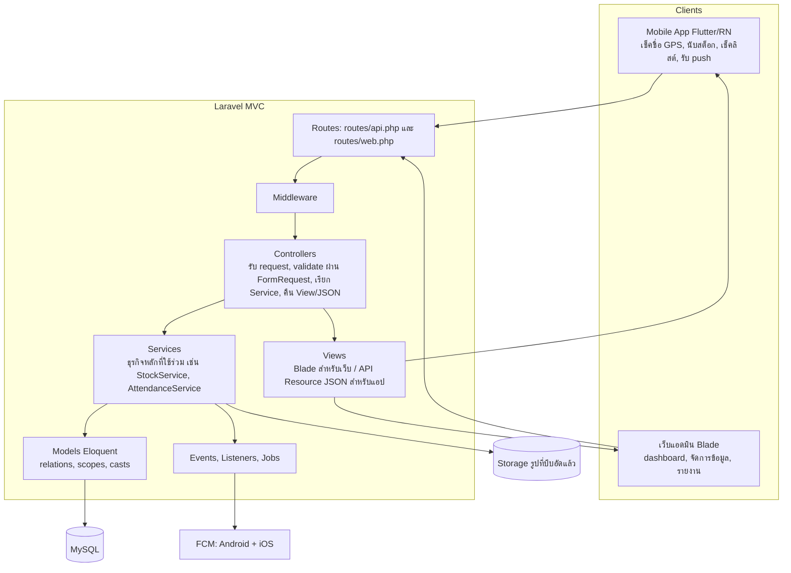
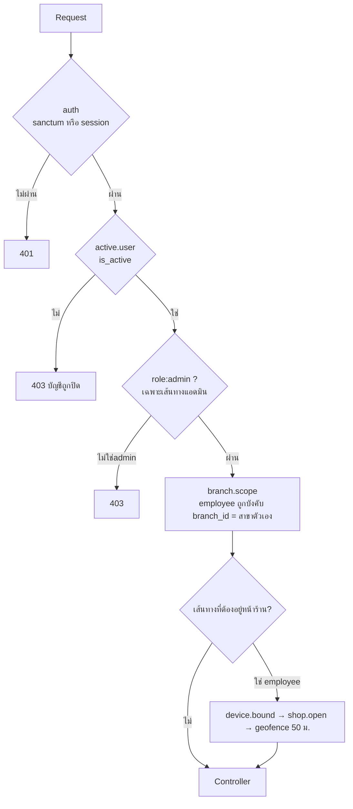
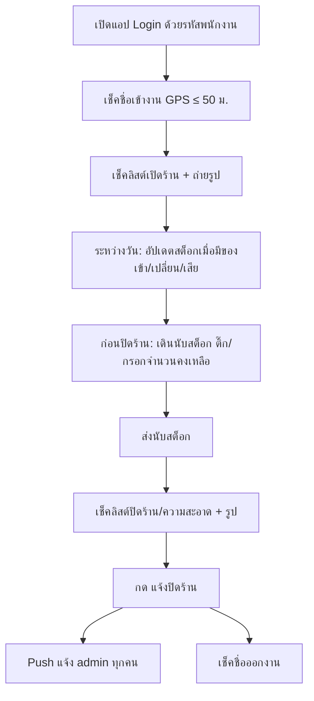
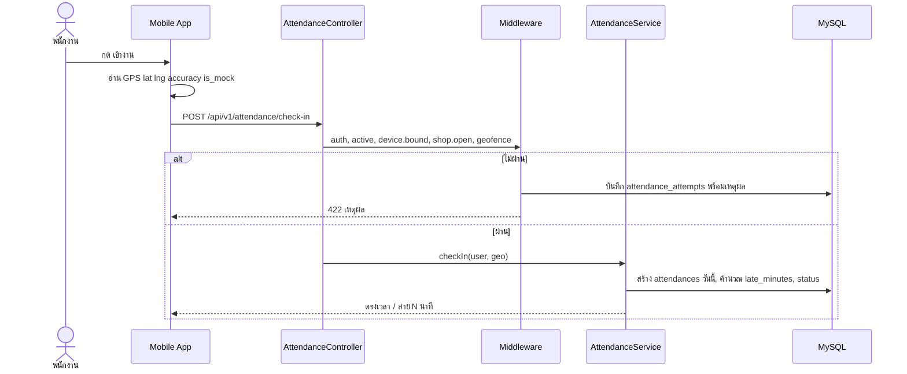
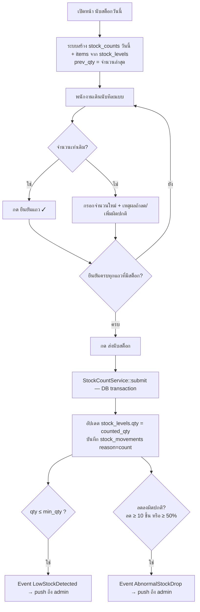
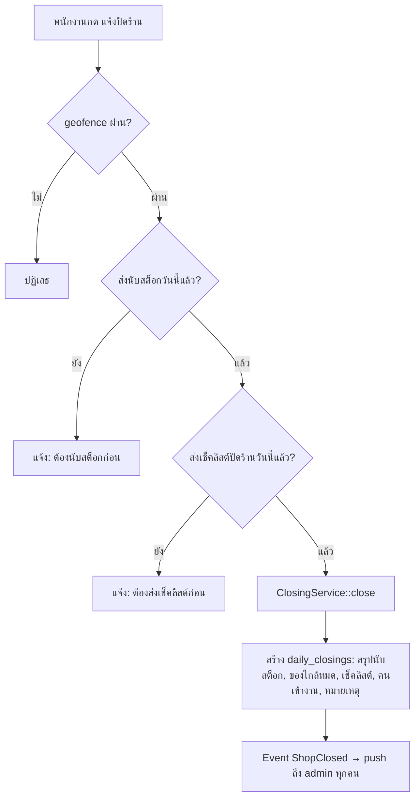
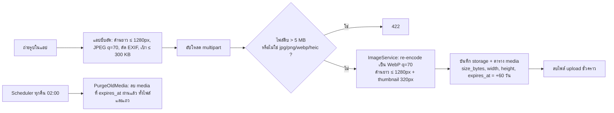
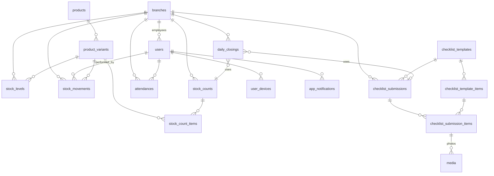

# ร้านชุดพยาบาล มินลดา — System Design Spec v2 (Laravel MVC)

> เอกสารนี้แทนที่ v1 ทั้งหมด เขียนให้ AI/Developer อ่านแล้วลงมือทำต่อได้ทันที
> Stack: **Laravel 11 (PHP 8.3) + MySQL 8 + Redis (queue) + Blade (เว็บแอดมิน) + REST API สำหรับแอปมือถือ + Sanctum + Firebase Cloud Messaging (push Android/iOS)**

## 0. สิ่งที่เปลี่ยนจาก v1

| หัวข้อ | v1 | v2 |
|--------|----|----|
| ระบบ POS / ยอดขาย | มี | **ตัดออก** (เพราะมีของเปลี่ยน/คืน ยอดจึงไม่ตรง) |
| การตัดสต็อก | ตัดอัตโนมัติจากการขาย | **พนักงานเดินนับเองทุกวัน** แล้วกรอกจำนวนคงเหลือ + อัปเดตสต็อกเมื่อมีของเข้า/เปลี่ยน/เสีย |
| Roles | owner/admin/branch_manager/staff | **2 role: `admin`, `employee`** |
| รัศมีเช็คชื่อ | 100 ม. | **50 ม.** ทุกสาขา |
| รูปเช็คลิสต์ | เก็บตามต้นฉบับ | **บีบอัด/ย่อขนาดทั้งฝั่งแอปและเซิร์ฟเวอร์** + ลบรูปเก่าอัตโนมัติ |
| เชียงใหม่ | เวลาไม่แน่ใจ | เชียงใหม่ 1 และ 2 **เวลาเดียวกัน** 08:30–18:30 หยุดวันอาทิตย์ |
| พิกัด | รอส่ง | ได้แล้ว 3 สาขา (ดู §1) |
| สถาปัตยกรรม | Service-based | **MVC** ชัดเจน + Service layer (ดู §3, §7) |
| ชื่อร้าน | มินลดาชุดพยาบาล | **ร้านชุดพยาบาล มินลดา** |

---

## 1. สาขา พิกัด และเวลาทำการ

| code | สาขา | เปิด | ปิด | วันหยุด | lat | lng | รัศมี |
|------|------|------|------|---------|-----|-----|-------|
| KKC | ขอนแก่น (ร้านหลัก) | 09:00 | 18:00 | - | 16.4390693 | 102.8277712 | 50 ม. |
| NMA | โคราช | 09:00 | 18:30 | - | 14.9887613 | 102.1046383 | 50 ม. |
| UBP | อุบลราชธานี | 09:00 | 18:30 | - | 15.2357186 | 104.8677354 | 50 ม. |
| CNX1 | เชียงใหม่ (1) นครพิงค์ | 08:30 | 18:30 | อาทิตย์ | 18.8536451 | 98.9686832 | 50 ม. |
| CNX2 | เชียงใหม่ (2) | 08:30 | 18:30 | อาทิตย์ | **ยังไม่มี** (สาขายังทำไม่เสร็จ) | **ยังไม่มี** | 50 ม. |

หมายเหตุพิกัด:
- ดึงจากลิงก์ Google Maps ที่ส่งมา (ค่า `!3d` = lat, `!4d` = lng)
- ครบแล้ว 4 สาขา (ขอนแก่น, โคราช, อุบลราชธานี, เชียงใหม่ 1) เหลือแค่เชียงใหม่ (2) ที่ยังไม่เปิดสาขา
- สาขาที่ไม่มีพิกัด (CNX2): seed `lat/lng = NULL` และ `is_active = false` จนกว่าสาขาจะเสร็จ แล้วให้ admin กรอกพิกัดในหน้าตั้งค่าสาขา ห้ามเปิดเช็คชื่อบนสาขาที่ไม่มีพิกัดโดยไม่แจ้งเตือน
- เวลา/พิกัด/รัศมีเก็บใน DB (`branches`) ห้าม hardcode; Timezone `Asia/Bangkok`; `grace_minutes = 10`

⚠️ **ข้อควรระวัง GPS ในร่ม:** รัศมี 50 ม. ค่อนข้างแคบ ในอาคาร GPS อาจคลาดเคลื่อน 20–40 ม. → ระบบตั้งค่า `max_accuracy_m` (ค่าเริ่มต้น 40) และเก็บ log ทุกครั้งที่ถูกปฏิเสธ เพื่อให้ปรับตัวเลขได้จากข้อมูลจริงในหน้าตั้งค่า

---

## 2. Roles และสิทธิ์ (มี 2 role)

`users.role` เป็น enum `admin | employee` (ไม่ต้องใช้ Spatie)

| ความสามารถ | admin | employee |
|-----------|:-----:|:--------:|
| Login ด้วยรหัสพนักงาน | ✅ | ✅ |
| เช็คชื่อเข้า/ออกงาน (ต้องอยู่ในรัศมี 50 ม.) | ไม่ต้อง (ทำแทนได้) | ✅ |
| นับสต็อกรายวัน (ติ๊ก/กรอกจำนวนคงเหลือ) | ✅ ทุกสาขา | ✅ สาขาตัวเอง |
| อัปเดตสต็อก (ของเข้า/เปลี่ยน/เสีย/แก้ไข) | ✅ ทุกสาขา | ✅ สาขาตัวเอง |
| ส่งเช็คลิสต์ความสะอาด + รูป | ✅ | ✅ |
| แจ้งปิดร้าน (สรุปประจำวัน) | ✅ | ✅ |
| ดู dashboard/รายงานทุกสาขา | ✅ | ❌ (ดูสรุปสาขาตัวเอง/ประวัติตัวเองเท่านั้น) |
| รีวิว/อนุมัติเช็คลิสต์ | ✅ | ❌ |
| จัดการสาขา (พิกัด/เวลา) | ✅ | ❌ |
| จัดการพนักงาน/อนุมัติเครื่อง | ✅ | ❌ |
| จัดการสินค้า/ไซส์/ค่าขั้นต่ำ | ✅ | ❌ |
| แก้เวลาเข้างานย้อนหลัง | ✅ | ❌ |
| รับ push แจ้งเตือน | ✅ ทุกสาขา | ✅ สาขาตัวเอง (เตือนนับสต็อก/ปิดร้าน) |

Employee ผูก 1 สาขา (`users.branch_id`) ; admin ไม่ผูกสาขา (`branch_id = NULL`)

---

## 3. สถาปัตยกรรม MVC



**หน้าที่แต่ละชั้น**

| ชั้น | ทำอะไร | ห้ามทำอะไร |
|------|--------|-----------|
| **Model** | โครงสร้างตาราง, relationships, scopes (`forBranch`, `today`), casts, enum | ห้ามมี logic ตัดสินใจซับซ้อน/เรียก HTTP |
| **View** | เว็บ: Blade + component (`resources/views`); แอป: `JsonResource` (`app/Http/Resources`) จัดรูปแบบข้อมูลขาออก | ห้าม query DB ใน Blade |
| **Controller** | รับ request → authorize (Policy) → validate (FormRequest) → เรียก Service → ส่ง View/Resource | ห้ามเขียน logic ธุรกิจยาว ๆ, ห้ามแก้ `stock_levels.qty` ตรง ๆ |
| **Service** | logic ที่ใช้ซ้ำหลาย controller (ตรวจ geofence, นับสต็อก, บีบอัดรูป, ปิดร้าน, ส่ง push) ใช้ DB transaction | ห้ามรู้จัก Request/Response |
| **Middleware** | ตรวจสิทธิ์/เงื่อนไขก่อนถึง controller (§4) | |
| **Policy** | ตรวจว่า user แก้ไข resource นั้นได้ไหม (เช่น employee แก้ได้เฉพาะสาขาตัวเอง) | |

### โครงสร้างโปรเจกต์

```
app/
  Enums/        Role, Size, StockReason, AttendanceStatus, ChecklistType, DocStatus
  Models/       Branch, User, UserDevice, Attendance, AttendanceAttempt,
                Product, ProductVariant, StockLevel, StockMovement,
                StockCount, StockCountItem,
                ChecklistTemplate, ChecklistTemplateItem, ChecklistSubmission, ChecklistSubmissionItem,
                DailyClosing, Media, AppNotification, Setting
  Http/
    Controllers/
      Admin/    (Blade) Dashboard, Branch, Employee, Product, Stock, StockCountReport,
                Attendance, ChecklistTemplate, ChecklistReview, Closing, Report, Device, Setting
      Api/V1/   (JSON) Auth, Me, Device, Attendance, StockCount, StockUpdate, Stock,
                Checklist, Closing, Notification
      Web/      AuthController (login เว็บ)
    Middleware/ EnsureActiveUser, EnsureRole, BranchScope, EnsureWithinGeofence,
                EnsureDeviceBound, EnsureShopOpen
    Requests/   Form Requests ทุก endpoint
    Resources/  JsonResource ของแต่ละ model
  Policies/     Branch, StockCount, ChecklistSubmission, Attendance ...
  Services/     AttendanceService, GeofenceService, StockService, StockCountService,
                ChecklistService, ClosingService, ImageService, PushService, ReportService
  Events/       LowStockDetected, OutOfStockDetected, AbnormalStockDrop, ShopClosed, ChecklistReviewed, StaffLate
  Listeners/    SendLowStockPush, SendOutOfStockPush, NotifyAdminShopClosed, NotifyAdminStaffLate ...
  Console/Commands/ StockCountReminder, ClosingReminder, MarkAbsent, PurgeOldMedia
  Support/Geo.php
resources/views/admin/...  (Blade layouts, components, tables)
database/migrations, seeders
tests/Feature, tests/Unit
```

---

## 4. Middleware Chain



| alias | หน้าที่ |
|-------|---------|
| `auth` | Sanctum token (แอป) / session (เว็บ) |
| `active.user` | ปฏิเสธถ้า `is_active = false` |
| `role:admin` | จำกัดเส้นทางแอดมิน |
| `branch.scope` | employee: ใส่ `branch_id` ของตัวเองให้ทุก query (Global Scope `BranchScoped`) และปฏิเสธถ้าพยายามระบุสาขาอื่น; admin ผ่านได้ |
| `device.bound` | ต้องเป็นเครื่องที่ลงทะเบียนและ admin อนุมัติแล้ว (กันเช็คชื่อแทนกัน) |
| `shop.open` | วันนี้สาขาเปิดไหม (`closed_weekdays`) เชียงใหม่วันอาทิตย์ = ปิด |
| `geofence` | คำนวณ Haversine กับพิกัดสาขา ต้อง ≤ 50 ม. และ accuracy ≤ `max_accuracy_m` และไม่ใช่ mock location |
| `throttle:attendance` | 10 ครั้ง/นาที/user |

**เส้นทางที่ต้องผ่าน geofence (สำหรับ employee):** เช็คชื่อเข้า/ออก, ส่งนับสต็อก, ส่งเช็คลิสต์, แจ้งปิดร้าน (เพราะต้องเดินนับ/ถ่ายรูปที่ร้านจริง) — admin ข้ามได้ทุกเส้นทาง
เปิด/ปิดกฎนี้รายการได้ที่ `settings` (`geofence_required_for_count`, `..._checklist`, `..._closing`)

```php
// app/Services/GeofenceService.php
public function check(Branch $branch, float $lat, float $lng, float $accuracy, bool $isMock): GeoResult
{
    if (!$branch->lat || !$branch->lng) return GeoResult::fail('สาขานี้ยังไม่ได้ตั้งพิกัด');
    $d = Geo::distanceMeters($lat, $lng, $branch->lat, $branch->lng);
    return match (true) {
        $isMock                                   => GeoResult::fail('ตรวจพบ Mock Location', $d),
        $accuracy > setting('max_accuracy_m', 40) => GeoResult::fail('สัญญาณ GPS ไม่แม่นพอ ลองใหม่', $d),
        $d > $branch->geofence_radius_m           => GeoResult::fail("อยู่นอกพื้นที่ร้าน ({$d} ม.)", $d),
        default                                   => GeoResult::ok($d),
    };
}
// Haversine ใน Geo::distanceMeters() รัศมีโลก 6371000 ม.  (server เป็นผู้ตัดสินเสมอ ห้ามเชื่อ client)
```

---

## 5. Flow การทำงาน

### 5.1 ภาพรวมรายวันของพนักงาน



### 5.2 เช็คชื่อ



กฎ: เข้าได้ตั้งแต่ `open_time - 60 นาที`; สายเมื่อเกิน `open_time + grace_minutes` → บันทึก `late_minutes` และ **ยิง event `StaffLate` แจ้ง admin ทันที (ไม่มีการหักเงิน/หักค่าแรงใด ๆ ในระบบ — เป็นแค่ข้อมูลแจ้งเตือน)**; 1 คน 1 แถว/วัน (`unique(user_id, work_date)`), เข้าซ้ำ → 409; ออกก่อน `close_time` ต้องใส่เหตุผล (`early_leave`); ลืมเช็ค → admin แก้มือพร้อม `manual_reason`; ผูก 1 user/1 เครื่อง เปลี่ยนเครื่องต้อง admin อนุมัติ; ใครไม่เช็คชื่อและสาขาเปิด → คำสั่งตอนเที่ยงคืนตีเป็น `absent`

**หมายเหตุ:** แต่ละสาขามีพนักงานประจำแค่ 1 คน จึงไม่ต้องทำระบบตารางเวร/ผูกพนักงานหลายคนต่อสาขา (`users.branch_id` เป็น 1:1 พอ); ถ้าพนักงานลาป่วย/ลากิจ ให้ admin เป็นคนเช็คชื่อ/นับสต็อกแทนได้ (admin ข้าม geofence และเลือกสาขาได้ทุกสาขา)

### 5.3 นับสต็อกรายวัน (แทน POS)

แนวคิด: ระบบเตรียมตารางให้ **แถว = แบบสินค้า, คอลัมน์ = ไซส์** ค่าตั้งต้นคือจำนวนที่นับล่าสุด พนักงานเดินนับจริงแล้ว "ติ๊กยืนยัน" หรือแก้จำนวน



- ทุก role นับได้ (admin นับแทนสาขาไหนก็ได้)
- **ส่งได้เมื่อยืนยันครบทุกแถว** เพื่อกันกดส่งลวก ๆ (แถวที่ `prev_qty = 0` ไม่ต้องกดยืนยัน แต่ต้องแก้ได้)
- ในวันเดียวกัน หลายคนเปิด draft เดียวกันได้ (`unique(branch_id, count_date)`); แต่ละ item เก็บ `counted_by`
- ส่งแล้วแก้ซ้ำในวันเดียวกันได้ (สร้างรอบ `revision` +1 และบันทึก movement ต่อเนื่อง)
- ไม่มี flow อนุมัติ — นับแล้วอัปเดตทันที แต่ทุกอย่างมีประวัติ (`stock_movements`) และ admin ดูส่วนต่างย้อนหลังได้ในรายงาน
- ค่าลดผิดปกติ (`abnormal_drop_qty`, `abnormal_drop_percent`) ตั้งได้ใน settings

### 5.4 อัปเดตสต็อกนอกรอบ

ใช้เมื่อมีของเข้า/เปลี่ยน/เสีย/โอนระหว่างสาขา โดยไม่ต้องรอนับ: เลือกสาขา (employee = สาขาตัวเอง) → เลือกสินค้า/ไซส์ → เลือกเหตุผล `receive | exchange | damaged | sold | transfer_in | transfer_out | correction` → ใส่จำนวน (+/-) หรือ "ตั้งเป็น N" → บันทึกผ่าน `StockService::change()` → บันทึก `stock_movements` (ใครทำ/เมื่อไร/หมายเหตุ) → ตรวจ low stock อัตโนมัติ

### 5.5 แจ้งปิดร้าน



- 1 สาขา 1 รายการ/วัน (`unique(branch_id, closing_date)`); ถ้ากดซ้ำถือว่าอัปเดตหมายเหตุ
- สาขาไหนเลย `close_time + 30 นาที` แล้วยังไม่ปิด → push เตือนพนักงานสาขานั้นและ admin

### 5.6 เช็คลิสต์ความสะอาด + การบีบอัดรูป



- ทำ 2 ชั้น: **ฝั่งแอป** ลดก่อนส่ง (ประหยัดเน็ตมือถือ) + **ฝั่งเซิร์ฟเวอร์ re-encode ซ้ำเสมอ** (รับประกันขนาด ไม่เชื่อ client)
- ใช้ `intervention/image` (driver GD/Imagick) ; ทำใน Queue job ก็ได้ถ้าช้า
- ประมาณการ: 5 สาขา × ~8 รูป/วัน × ~150–300 KB ≈ 6–12 MB/วัน → เก็บ 60 วัน ≈ 0.4–0.7 GB (ตั้ง `media_retention_days` ใน settings; รูปที่ admin กด "ปักหมุด/เก็บถาวร" ข้ามการลบ)
- ใช้ private disk + signed URL เท่านั้น, ห้ามเปิดสาธารณะ

### 5.7 แจ้งเตือน Push (มือถือจริง Android + iOS)

| เหตุการณ์ | ผู้รับ | ตัวอย่างข้อความ |
|-----------|--------|-----------------|
| สินค้า ≤ min_qty (ครั้งแรก) | admin | ⚠️ อุบล: เข็มขัด เหลือ 4 (ขั้นต่ำ 5) |
| สินค้าลดจนเหลือ 0 (ครั้งแรก) | admin | 🚨 อุบล: เข็มขัด หมดแล้ว รีบเติมของสาขานี้ |
| สต็อกลดผิดปกติ | admin | 🔎 โคราช: เทเลอแหลมสั้น M ลด 20→6 |
| สรุปของใกล้หมดทุกสาขา (09:00) | admin | 📋 ใกล้หมด 12 รายการ |
| ใกล้ปิดร้านยังไม่นับสต็อก (`close_time - 30 น.`) | employee สาขานั้น | ⏰ อย่าลืมนับสต็อกวันนี้ |
| พนักงานเช็คชื่อเข้างานสาย | admin | 🕒 อุบล: มาสาย 15 นาที (ไม่หักเงิน) |
| แจ้งปิดร้านแล้ว | admin | ✅ ขอนแก่นปิดร้านแล้ว 18:07 |
| เลยเวลาปิด 30 น. ยังไม่แจ้งปิด | employee + admin | ❗ สาขา… ยังไม่แจ้งปิดร้าน |
| เช็คลิสต์ถูกตีกลับ | ผู้ส่ง | 🔁 เช็คลิสต์ถูกส่งกลับ: … |

- แอปลงทะเบียน `fcm_token` ที่ `POST /api/v1/devices`; ส่งผ่าน `kreait/laravel-firebase` ใน queue; token ที่ FCM ตอบ `UNREGISTERED` ให้ลบทิ้ง
- กันแจ้งซ้ำด้วย `stock_levels.low_stock_alerted_at` (รีเซ็ตเมื่อ qty > min_qty)
- เก็บประวัติในตาราง `app_notifications` ให้แอปเปิดดูย้อนหลัง/กดอ่านได้
- payload มี `data: {type, branch_id, variant_id}` เพื่อ deep link เข้าหน้าที่เกี่ยวข้อง

---

## 6. ฐานข้อมูล

### 6.1 ERD



### 6.2 คอลัมน์

**branches**: `id, code(unique), name, address, lat decimal(10,7) null, lng decimal(10,7) null, geofence_radius_m int default 50, geofence_enabled bool default true, open_time, close_time, closed_weekdays json (0=อาทิตย์), grace_minutes default 10, is_active, timestamps`

**users**: `id, employee_code(unique เช่น KKC-001), name, phone, password, role enum(admin,employee), branch_id null, is_active, last_login_at, timestamps`

**user_devices**: `id, user_id, device_uid, platform enum(android,ios), fcm_token null, is_approved bool, last_seen_at` — unique(user_id, device_uid)

**attendances**: `id, user_id, branch_id, work_date, check_in_at, check_in_lat, check_in_lng, check_in_accuracy, check_in_distance_m, check_out_at, check_out_lat, check_out_lng, check_out_distance_m, late_minutes, status enum(on_time,late,early_leave,absent,manual), note, manual_reason, edited_by` — unique(user_id, work_date)

**attendance_attempts** (audit ทุกครั้งที่ไม่ผ่าน): `id, user_id, branch_id, action, lat, lng, accuracy, distance_m, reason, device_uid, ip, created_at`

**products**: `id, code, name, category enum(top,pants,skirt,accessory,hat), has_sizes bool, sort, is_active`

**product_variants**: `id, product_id, sku(unique), size enum null, option string null, sort, is_active` (ไม่มีราคา เพราะไม่มี POS; เพิ่ม `price` ภายหลังได้ถ้าต้องการ)

**stock_levels**: `id, branch_id, variant_id, qty int default 0, min_qty int default 7, out_of_stock_alerted_at, last_counted_at, last_counted_by, low_stock_alerted_at` — unique(branch_id, variant_id)

**stock_movements** (ledger เขียนอย่างเดียว ห้ามแก้/ลบ): `id, branch_id, variant_id, reason enum(initial,count,receive,exchange,damaged,sold,transfer_in,transfer_out,correction), qty_before, qty_change, qty_after, ref_type, ref_id, user_id, note, created_at`

**stock_counts**: `id, branch_id, count_date, status enum(draft,submitted), revision int default 0, started_by, submitted_by, submitted_at, note` — unique(branch_id, count_date)
**stock_count_items**: `id, stock_count_id, variant_id, prev_qty, counted_qty null, diff, is_confirmed bool, counted_by, reason null` — unique(stock_count_id, variant_id)

**checklist_templates**: `id, type enum(opening,closing,cleanliness), name, is_active`
**checklist_template_items**: `id, template_id, label, require_photo bool, sort`
**checklist_submissions**: `id, branch_id, template_id, check_date, submitted_by, submitted_at, status enum(draft,submitted,approved,rejected), score null, reviewed_by, reviewed_at, review_note` — unique(branch_id, template_id, check_date)
**checklist_submission_items**: `id, submission_id, template_item_id, is_ok bool, note`

**media** (polymorphic รูปทั้งหมด): `id, mediable_type, mediable_id, disk, path, thumb_path, mime, size_bytes, width, height, created_by, expires_at null, is_pinned bool default false, created_at`

**daily_closings**: `id, branch_id, closing_date, closed_by, closed_at, stock_count_id, closing_submission_id null, low_stock_count int, staff_present int, note` — unique(branch_id, closing_date)

**app_notifications**: `id, user_id, type, title, body, data json, read_at null, created_at`

**settings** (key/value): `max_accuracy_m=40, geofence_required_for_count/checklist/closing=true, abnormal_drop_qty=10, abnormal_drop_percent=50, media_retention_days=60, default_min_qty=7, default_min_qty_accessory=5`

Index สำคัญ: `stock_movements(branch_id, variant_id, created_at)`, `attendances(branch_id, work_date)`, `stock_counts(branch_id, count_date)`, `media(mediable_type, mediable_id)`, `media(expires_at)`

### 6.3 Eloquent Relationships

| Model | ความสัมพันธ์ |
|-------|--------------|
| `Branch` | hasMany `User`, `StockLevel`, `StockMovement`, `StockCount`, `Attendance`, `ChecklistSubmission`, `DailyClosing` |
| `User` | belongsTo `Branch`; hasMany `Attendance`, `UserDevice`, `AppNotification`, `StockMovement` (performed) |
| `UserDevice` | belongsTo `User` |
| `Attendance` | belongsTo `User`, `Branch`, `editor` (User) |
| `Product` | hasMany `ProductVariant` |
| `ProductVariant` | belongsTo `Product`; hasMany `StockLevel`, `StockMovement`, `StockCountItem` |
| `StockLevel` | belongsTo `Branch`, `ProductVariant`, `lastCountedBy` (User) |
| `StockMovement` | belongsTo `Branch`, `ProductVariant`, `User`; morphTo `ref` |
| `StockCount` | belongsTo `Branch`, `startedBy`, `submittedBy` (User); hasMany `StockCountItem`; hasOne `DailyClosing` |
| `StockCountItem` | belongsTo `StockCount`, `ProductVariant`, `countedBy` (User) |
| `ChecklistTemplate` | hasMany `ChecklistTemplateItem`, `ChecklistSubmission` |
| `ChecklistTemplateItem` | belongsTo `ChecklistTemplate`; hasMany `ChecklistSubmissionItem` |
| `ChecklistSubmission` | belongsTo `Branch`, `ChecklistTemplate`, `submitter`, `reviewer` (User); hasMany `ChecklistSubmissionItem` |
| `ChecklistSubmissionItem` | belongsTo `ChecklistSubmission`, `ChecklistTemplateItem`; **morphMany `Media`** |
| `DailyClosing` | belongsTo `Branch`, `closedBy` (User), `StockCount`, `closingSubmission` (ChecklistSubmission) |
| `Media` | morphTo `mediable`; belongsTo `creator` (User) |
| `AppNotification` | belongsTo `User` |

Trait `BranchScoped` (Global Scope) ใส่ใน: `StockLevel, StockMovement, StockCount, Attendance, ChecklistSubmission, DailyClosing` → employee เห็นเฉพาะสาขาตัวเองอัตโนมัติ

---

## 7. Controllers — ใครจัดการอะไร

### 7.1 Api\V1 (แอปมือถือ ตอบ JSON ผ่าน API Resource) — ใช้ได้ทั้ง admin/employee ตามสิทธิ์

| Controller | Model หลัก | จัดการอะไร | Actions / Endpoint | Middleware พิเศษ |
|-----------|-----------|-----------|--------------------|-----------------|
| `AuthController` | User | login ด้วย employee_code+password, logout, เปลี่ยนรหัสผ่าน | `POST /auth/login`, `POST /auth/logout`, `POST /auth/change-password` | throttle |
| `MeController` | User, Branch | โปรไฟล์ตัวเอง + ข้อมูลสาขา + สถานะวันนี้ (เข้างานแล้ว? นับแล้ว? ปิดร้านแล้ว?) | `GET /me`, `GET /me/today` | auth |
| `DeviceController` | UserDevice | ลงทะเบียนเครื่อง/FCM token, ลบ token ตอน logout | `POST /devices`, `DELETE /devices/{uid}` | auth |
| `AttendanceController` | Attendance, AttendanceAttempt | เข้า/ออกงาน, ประวัติของตัวเอง | `POST /attendance/check-in`, `POST /attendance/check-out`, `GET /attendance/me?month=` | device.bound, shop.open, geofence, throttle |
| `StockController` | StockLevel, ProductVariant | ดูสต็อกคงเหลือ (ตารางแบบ×ไซส์), กรองใกล้หมด, ดูประวัติเคลื่อนไหว | `GET /stock`, `GET /stock/low`, `GET /stock/movements` | branch.scope |
| `StockCountController` | StockCount, StockCountItem | เปิดรอบนับวันนี้, บันทึกทีละแถว (autosave), ยืนยันแถว, ส่งนับ | `GET /stock-counts/today`, `PUT /stock-counts/{id}/items/{variant}`, `POST /stock-counts/{id}/confirm-row`, `POST /stock-counts/{id}/submit` | branch.scope, geofence (employee) |
| `StockUpdateController` | StockMovement, StockLevel | อัปเดตสต็อกนอกรอบ (ของเข้า/เปลี่ยน/เสีย/โอน/แก้) | `POST /stock/updates` | branch.scope, geofence (employee) |
| `ChecklistController` | ChecklistTemplate, ChecklistSubmission(+Item), Media | ดึงเช็คลิสต์วันนี้, บันทึกทีละข้อ, อัปโหลดรูป (บีบอัด), ส่ง | `GET /checklists/today`, `PUT /checklists/{id}/items/{item}`, `POST /checklists/{id}/items/{item}/photos`, `POST /checklists/{id}/submit` | branch.scope, geofence (employee) |
| `ClosingController` | DailyClosing | ตรวจความพร้อมปิดร้าน, แจ้งปิดร้าน, ดูสถานะวันนี้ | `GET /closing/today`, `POST /closing` | branch.scope, geofence (employee) |
| `NotificationController` | AppNotification | รายการแจ้งเตือนในแอป, ทำเครื่องหมายอ่านแล้ว | `GET /notifications`, `POST /notifications/{id}/read`, `POST /notifications/read-all` | auth |

### 7.2 Admin (เว็บ Blade) — ทุกตัว `auth` + `active.user` + `role:admin`

| Controller | Model หลัก | จัดการอะไร | Actions (resource) |
|-----------|-----------|-----------|--------------------|
| `DashboardController` | หลายตาราง | ภาพรวมวันนี้: สาขาไหนเข้างานกี่คน/สาย/ขาด, ใครนับสต็อกแล้ว, ปิดร้านแล้วหรือยัง, ของใกล้หมด, เช็คลิสต์รอรีวิว | `index` |
| `BranchController` | Branch | เพิ่ม/แก้สาขา, **พิกัด lat/lng, รัศมี, เวลาเปิด-ปิด, วันหยุด**, เปิด/ปิดสาขา, ปุ่ม "ทดสอบระยะจากตำแหน่งฉัน" | `index, create, store, edit, update` |
| `EmployeeController` | User | เพิ่ม/แก้พนักงาน, สร้างรหัสพนักงาน, รีเซ็ตรหัสผ่าน, ย้ายสาขา, เปิด/ปิดบัญชี | `index, create, store, edit, update, resetPassword, toggleActive` |
| `DeviceController` | UserDevice | อนุมัติ/ปฏิเสธ/ยกเลิกเครื่องของพนักงาน | `index, approve, revoke` |
| `ProductController` | Product, ProductVariant | จัดการแบบสินค้า + ไซส์/option (SKU), ลำดับแสดงผล, ค่าขั้นต่ำต่อสาขา (`min_qty`) | `index, create, store, edit, update, destroy(soft), updateMinQty` |
| `StockController` | StockLevel, StockMovement | ดูสต็อกทุกสาขาแบบเมทริกซ์, แก้สต็อกแทน, ดู ledger ประวัติ | `index, show(branch), movements, adjust` |
| `StockCountReportController` | StockCount, StockCountItem | ประวัติการนับรายวัน, ส่วนต่าง (prev vs counted), ใครนับ, รายการลดผิดปกติ, ส่งออก Excel | `index, show, export` |
| `AttendanceController` | Attendance, AttendanceAttempt | ตารางเข้า-ออก/สาย/ขาด, log ความพยายามที่ไม่ผ่าน (ไว้ปรับรัศมี/accuracy), แก้มือ+เหตุผล, สรุปรายเดือนต่อคน | `index, show, edit, update, attempts, monthly` |
| `ChecklistTemplateController` | ChecklistTemplate(+Item) | สร้าง/แก้แม่แบบเช็คลิสต์ (เปิดร้าน/ปิดร้าน/ความสะอาด) กำหนดข้อที่ต้องมีรูป | `index, create, store, edit, update` |
| `ChecklistReviewController` | ChecklistSubmission, Media | ดูเช็คลิสต์+รูปที่ส่งมา, อนุมัติ/ตีกลับ/ให้คะแนน, ปักหมุดรูปไม่ให้ถูกลบ | `index, show, approve, reject, pinMedia` |
| `ClosingController` | DailyClosing | ดูรายการแจ้งปิดร้านรายวันของทุกสาขา, สาขาไหนยังไม่ปิด | `index, show` |
| `ReportController` | หลายตาราง | รายงานรายวัน/รายเดือน (เข้างาน, สต็อกใกล้หมด, ความถี่ที่ส่งเช็คลิสต์), ส่งออก Excel/PDF | `daily, monthly, export` |
| `SettingController` | Setting | ค่ากลาง: max_accuracy_m, กฎ geofence, เกณฑ์ลดผิดปกติ, วันเก็บรูป | `edit, update` |
| `Web\AuthController` | User | หน้า login เว็บ (employee_code) + logout | `showLogin, login, logout` |

> พนักงานที่ใช้เว็บ (ไม่ใช่แอป) ให้ใช้ระบบเดียวกันผ่านหน้า `/employee/*` ที่ reuse Service เดิม (ทางเลือก, เฟสหลัง) — logic ทั้งหมดอยู่ใน Service จึงไม่ซ้ำ

### 7.3 Services (ตัวที่ Controller เรียกใช้ร่วม)

| Service | หน้าที่ |
|---------|---------|
| `GeofenceService` | Haversine + กฎ accuracy/mock + บันทึก attempt |
| `AttendanceService` | check-in/out, คำนวณสาย/ออกก่อน, ตีขาดงาน |
| `StockService` | **ทางเดียว** ที่แก้ `stock_levels.qty` — lockForUpdate, เขียน movement, ตรวจ low stock/ลดผิดปกติ, dispatch event |
| `StockCountService` | สร้าง draft จาก stock_levels, บันทึกแถว, ตรวจครบก่อนส่ง, submit (เรียก StockService) |
| `ChecklistService` | สร้างเช็คลิสต์วันนี้จาก template, บันทึกข้อ, ตรวจรูปครบตาม `require_photo`, submit/review |
| `ImageService` | validate, re-encode WebP, thumbnail, บันทึก media, purge |
| `ClosingService` | ตรวจเงื่อนไข (นับแล้ว+เช็คลิสต์ปิดร้านแล้ว) แล้วสร้าง `daily_closings` + event |
| `PushService` | ส่ง FCM แบบ batch, จัดการ token เสีย, บันทึก app_notifications |
| `ReportService` | รวมข้อมูลรายวัน/รายเดือน |

```php
// StockService::change  (หัวใจ — ห้ามอัปเดต qty ที่อื่น)
public function change(int $branchId, int $variantId, int $newQty, StockReason $reason, ?Model $ref = null, ?string $note = null): StockLevel
{
    return DB::transaction(function () use ($branchId, $variantId, $newQty, $reason, $ref, $note) {
        $lv = StockLevel::withoutGlobalScopes()->where('branch_id',$branchId)->where('variant_id',$variantId)
              ->lockForUpdate()->firstOrCreate([...], ['qty'=>0]);
        throw_if($newQty < 0, InvalidStockException::class);
        $before = $lv->qty;
        StockMovement::create([... 'qty_before'=>$before, 'qty_change'=>$newQty-$before, 'qty_after'=>$newQty,
                               'reason'=>$reason, 'user_id'=>auth()->id(), 'note'=>$note]);
        $lv->update(['qty'=>$newQty]);
        // ลดผิดปกติ
        if ($before - $newQty >= setting('abnormal_drop_qty') ||
            ($before > 0 && ($before-$newQty)/$before*100 >= setting('abnormal_drop_percent')))
            event(new AbnormalStockDrop($lv, $before));
        // หมดสต็อก (qty = 0) — แจ้งเตือนแรงกว่าใกล้หมด แจ้งครั้งเดียวจนกว่าจะเติม
        if ($newQty === 0 && !$lv->out_of_stock_alerted_at) {
            $lv->update(['out_of_stock_alerted_at'=>now()]); event(new OutOfStockDetected($lv));
        } elseif ($newQty > 0 && $lv->out_of_stock_alerted_at) {
            $lv->update(['out_of_stock_alerted_at'=>null]);
        }
        // ใกล้หมด (แจ้งครั้งเดียวจนกว่าจะเติม) — ไม่ยิงซ้ำตอน qty=0 (มี OutOfStockDetected แล้ว)
        if ($newQty > 0 && $newQty <= $lv->min_qty && !$lv->low_stock_alerted_at) {
            $lv->update(['low_stock_alerted_at'=>now()]); event(new LowStockDetected($lv));
        } elseif ($newQty > $lv->min_qty && $lv->low_stock_alerted_at) {
            $lv->update(['low_stock_alerted_at'=>null]);
        }
        return $lv;
    });
}
```

---

## 8. Scheduler (`routes/console.php`)

| เวลา | Command | ทำอะไร |
|------|---------|--------|
| 09:00 | `stock:low-digest` | push สรุปของใกล้หมดทุกสาขาให้ admin |
| ทุก 10 นาที | `stock:count-reminder` | ถึง `close_time - 30 น.` และยังไม่ส่งนับ → เตือนพนักงานสาขานั้น (ข้ามสาขาที่ปิดวันนั้น) |
| ทุก 10 นาที | `closing:reminder` | เลย `close_time + 30 น.` ยังไม่แจ้งปิด → เตือนพนักงาน + admin |
| 00:10 | `attendance:mark-absent` | ตีขาดงานเมื่อสาขาเปิดแต่พนักงานไม่มีเช็คชื่อ |
| 02:00 | `media:purge` | ลบรูปหมดอายุ (ยกเว้น `is_pinned`) |

Supervisor รัน `queue:work redis` และ cron `* * * * * php artisan schedule:run`

---

## 9. Views

**เว็บแอดมิน (Blade, `resources/views/admin/`)**: layout หลัก + sidebar (แดชบอร์ด, สาขา, พนักงาน, เครื่อง, สินค้า, สต็อก, รายงานนับสต็อก, เข้างาน, เช็คลิสต์, ปิดร้าน, รายงาน, ตั้งค่า) — ตารางสต็อกแสดงแบบ **แถว = แบบ, คอลัมน์ = ไซส์ SSS…5XL** เหมือนใบสั่งชุด และไฮไลต์ช่องที่ ≤ min_qty เป็นสีแดง

**แอปมือถือ (หน้าจอ)**: Login → Home (สถานะวันนี้ ✓เข้างาน ✓นับสต็อก ✓เช็คลิสต์ ✓ปิดร้าน) → เช็คชื่อ → นับสต็อก (เมทริกซ์แบบ×ไซส์, ปุ่ม +/−, ปุ่มยืนยันแถว, autosave) → อัปเดตสต็อก → เช็คลิสต์ (ถ่ายรูปในแอป+บีบอัด) → แจ้งปิดร้าน → แจ้งเตือน

**API Resources**: `UserResource, BranchResource, AttendanceResource, StockMatrixResource, StockCountResource, ChecklistResource, MediaResource (signed URL), ClosingResource, NotificationResource`

---

## 10. Master Data สินค้า (ถอดจากใบสั่งชุด)

ไซส์: `SSS, SS, S, M, L, XL, XXL, 3XL, 4XL, 5XL`

| # | แบบ | ตัวเลขในรูป (ไซส์:จำนวน) |
|---|-----|--------------------------|
| 1 | กรุงเทพ ยาว | S:5, XL:3 |
| 2 | กรุงเทพ สั้น | S:5, M:5 |
| 3 | บัวมน | M:5 |
| 4 | เทเลอมน | — |
| 5 | ปีกนก | XL:5 |
| 6 | เทเลอแหลม สั้น | SS:15, S:20, M:20, L:15, XL:10, XXL:3, 3XL:4, 4XL:4 |
| 7 | เทเลอแหลม ยาว | S:5 |
| 8 | บัวป้าย สั้น วัฒนา | M:5 |
| 9 | บัวป้าย ยาว วัฒนา | XL:4 |
| 10 | จีนแยก | M:4 |
| 11 | คอปีนสั้น | — |
| 12 | คอปีน ยาว | S:3 |
| 13 | ลานนา | M:4 |
| 14 | จีนป้าย สั้น | XL:5 |
| 15 | จีนป้าย ยาว | SS:5 |
| 16 | จีนตรง สั้น | — |
| 17 | จีนตรง ยาว | — |
| 18 | ริ้วฟ้าคอปก | — |
| 19 | กวนู่คอปก | — |
| 20 | พิธีการ สั้น | S:8, M:8, L:8, 4XL:3 |
| 21 | พิธีการ ยาว | S:5, M:5, L:3 |
| 22 | กระโปรง ทรงเอ | M:4, L:5, XL:5, XXL:5 |
| 23 | กระโปรง ทรงตรง | SSS:5, SS:5, S:10, M:5, L:5, XL:5 |
| 24 | กางเกง | ตารางด้านล่าง |

กางเกง (option `normal` = บรรทัดแรก, `plus` = บรรทัดที่มี "+" — ความหมาย "+" ยังไม่ยืนยัน):

| ไซส์ | SSS | SS | S | M | L | XL | XXL | 3XL | 4XL | 5XL |
|------|-----|----|---|---|---|----|-----|-----|-----|-----|
| normal | 20 | 20 | 20 | 20 | 20 | 20 | 5 | 5 | — | 5 |
| plus | — | — | 20 | 20 | 20 | 15 | 5 | — | — | — |

อุปกรณ์เสริม (ไม่มีไซส์ `has_sizes=false`, จะแสดงเป็นคอลัมน์เดียวในหน้านับ):
`เข็มขัด, กระดุมแขนพิธีการ, กระดุมกระทรวง, เข็มพยาบาล, เข็มผู้ช่วย, หมวกผู้ช่วย, หมวกพยาบาล`

Seeder: สร้าง products + variants ครบทุกไซส์ที่ใช้; สร้าง `stock_levels` ทุกสาขา × ทุก variant ค่าเริ่มต้น 0, `min_qty` = **7** สำหรับชุด/กระโปรง/กางเกงทุกไซส์ และ **5** สำหรับอุปกรณ์เสริม 6 รายการ (กระดุมแขนพิธีการ, กระดุมกระทรวง, เข็มพยาบาล, เข็มผู้ช่วย, หมวกผู้ช่วย, หมวกพยาบาล — อยู่ใน §10 แล้วครบทั้ง 6 รายการ ไม่ต้องเพิ่มซ้ำ); ตัวเลขในรูปให้ใส่เป็น movement `initial` ของ **ขอนแก่น** *ถ้าเจ้าของยืนยันว่าเป็นสต็อกคงเหลือ* (ไม่เช่นนั้นเริ่ม 0 แล้วให้พนักงานนับรอบแรก) — seed แม่แบบเช็คลิสต์: เปิดร้าน, ปิดร้าน, ความสะอาด (กวาด/ถูพื้น, เช็ดกระจก, จัดชุดตามไซส์, ป้ายราคาครบ, ห้องลองชุด, พนักงานแต่งกายเรียบร้อย, ถังขยะ, ปิดไฟ/แอร์/ล็อกประตู)

---

## 11. Security / NFR

- Password bcrypt/argon2, throttle login, ล็อกชั่วคราวเมื่อผิดหลายครั้ง, revoke token เมื่อ logout/ปิดบัญชี
- FormRequest validate ทุก endpoint; Policy กันข้ามสาขา; ทดสอบว่า employee เรียก API ด้วย `branch_id` สาขาอื่นแล้วโดน 403
- HTTPS บังคับ; storage รูป private + signed URL อายุสั้น
- `stock_movements`, `attendance_attempts` เป็น append-only
- Backup DB รายวัน; log ข้อผิดพลาดด้วย Sentry/Laravel Log
- Test ที่ต้องมี: geofence (ในรัศมี 49/51 ม., accuracy แย่, mock), branch scope, StockService (concurrent), การ submit นับสต็อกต้องยืนยันครบ, ClosingService เงื่อนไข, ImageService (ไฟล์ใหญ่ → ผลลัพธ์ ≤ 300 KB), เชียงใหม่วันอาทิตย์ถูกบล็อกเช็คชื่อ

---

## 12. แผนพัฒนาเป็นเฟส

| เฟส | งาน | Definition of Done |
|-----|-----|--------------------|
| 1 | Laravel setup, migrations §6, Enums, Models+relations+BranchScoped, Seeders (สาขา §1, สินค้า §10, template, settings, admin 1 คน), Auth ด้วย employee_code, middleware §4 | `migrate --seed` ผ่าน, login ได้ 2 role, test branch scope ผ่าน |
| 2 | Admin: Branch, Employee, Device, Setting + Attendance API + Geofence 50 ม. + attempts log | test 49/51 ม., สาย/ตรงเวลา, เชียงใหม่วันอาทิตย์ถูกบล็อก |
| 3 | Product, StockService, StockController (admin+API), StockUpdate | ledger ถูกต้อง, ไม่ติดลบ, low stock event ทำงาน |
| 4 | StockCount (draft/แถวยืนยัน/submit) + รายงานส่วนต่าง + ลดผิดปกติ | ส่งไม่ได้ถ้ายังไม่ยืนยันครบ, qty อัปเดตหลังส่ง |
| 5 | ImageService + Checklist template/submit/review | รูป ≤ 300 KB, thumbnail, purge ทำงาน |
| 6 | Closing + Scheduler + Push (FCM) + app_notifications | push ถึงมือถือจริง Android+iOS |
| 7 | Admin Dashboard + Report + Export Excel | ตัวเลขตรงกับข้อมูลดิบ |
| 8 | Mobile app (Flutter/RN) ทุกหน้าจอ §9 | ทดสอบหน้าร้านจริง ทุกสาขา |
| 9 | (ทางเลือก) โอนสต็อกระหว่างสาขาแบบมี 2 ฝั่ง, ราคา/มูลค่าสต็อก | |

### Prompt เริ่มต้นสำหรับ AI

```
อ่านไฟล์ minlada-nurse-shop-system-spec-v2.md ทั้งหมด แล้วทำ "เฟส N" ตามตาราง §12
กติกา: Laravel 11 / PHP 8.3 / MySQL; สถาปัตยกรรม MVC + Service ตาม §3 และ §7;
มี role แค่ admin กับ employee (ไม่มี POS); รัศมีเช็คชื่อ 50 ม.; ห้ามแก้ stock_levels.qty นอก StockService;
รูปทุกใบต้องผ่าน ImageService; เขียน Feature test ควบคู่; เมื่อเสร็จสรุปไฟล์ที่สร้างและคำสั่งรัน แล้วรอสั่งเฟสถัดไป
```

---

## 13. คำถามที่ยังต้องยืนยัน

1. พิกัดเชียงใหม่ (2) เมื่อสาขาเสร็จ
2. ตัวเลขในรูปใบสั่งชุดคือสต็อกคงเหลือ หรือจำนวนที่สั่ง (ใช้ตัดสินว่าจะ seed เป็นสต็อกเริ่มต้นไหม)
3. "กางเกง +" หมายถึงอะไร (ยาวพิเศษ? รุ่นอื่น?)
4. เกณฑ์ "ลดผิดปกติ" (ตอนนี้ ≥10 ชิ้น หรือ ≥50%) เหมาะไหม
5. พนักงานเชียงใหม่สาขา 1 และ 2 เป็นคนละคนกันใช่ไหม (ยืนยันว่าแต่ละสาขามีพนักงานแค่ 1 คนตามที่บอก)
6. ต้องการ selfie ตอนเช็คชื่อไหม
7. เลือกแอปมือถือ Flutter หรือ React Native (แนะนำ Flutter)
8. เซิร์ฟเวอร์ที่จะใช้ (แนะนำ VPS ในไทย + Redis + Supervisor)
